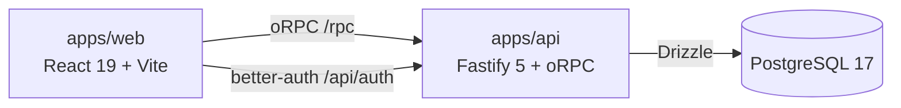

# Beautiful TodoApp


Todo-приложение уровня production: монорепо, сквозная типобезопасность от БД до кнопок в UI, авторизация, тесты, CI, наблюдаемость. Legacy-CRA-версия сохранена под тегом [`v0-legacy`](../../tree/v0-legacy).


## Возможности

- регистрация и вход (email + пароль), сессия в httpOnly-cookie, переживает перезагрузку;
- задачи пользователя: создание, completion, приоритет, удаление, поиск, фильтры (All / Active / Done);
- данные изолированы по владельцу — каждый видит только свои задачи;
- адаптивная верстка, состояние сохраняется в PostgreSQL.

|                                           |                                               |
| ----------------------------------------- | --------------------------------------------- |
|  |  |

## Стек

| Слой          | Технологии                                                                      |
| ------------- | ------------------------------------------------------------------------------- |
| Frontend      | React 19, Vite 8, TypeScript 6, TanStack Router/Query, Effector, Tailwind 4     |
| Backend       | Node.js 24, Fastify 5, oRPC, Drizzle ORM, PostgreSQL 17                         |
| Auth          | better-auth (email+password, httpOnly cookie)                                   |
| Контракт      | zod-схемы в `packages/shared`: один источник типов для клиента и сервера        |
| Качество      | Vitest, Testing Library, Playwright, ESLint, Prettier, GitHub Actions, Renovate |
| Наблюдаемость | Sentry (env-gated), request-id сквозной FE→BE                                   |

## Архитектура



- Серверное состояние — TanStack Query (оптимистичные мутации), клиентское (фильтры, сессия) — Effector, маршрутизация — TanStack Router с guard'ом авторизации.
- oRPC-контракт из `@bt/shared` типизирует и клиент, и сервер, включая ошибки авторизации.
- Без запущенного бэкенда web работает на in-process моке (`VITE_USE_MOCKS=1`) с фиксированной демо-сессией.

```
apps/web        SPA: app / pages / features / entities / shared (FSD-слои)
apps/api        Fastify: oRPC-роутер, better-auth, Drizzle-миграции и сид
packages/shared zod-контракты и типы, общие для web и api
packages/config общие конфиги eslint/typescript/prettier
e2e             Playwright-сценарии на прод-сборках
docs/adr        архитектурные решения (ADR)
```

## Быстрый старт

Требуется Node.js 24 (`nvm use`) и Docker.

```bash
pnpm install
cp apps/api/.env.example apps/api/.env
cp apps/web/.env.example apps/web/.env
pnpm db:up                                # postgres:17 на 5433
pnpm --filter @bt/api db:migrate
pnpm --filter @bt/api db:seed
pnpm dev                                  # web http://localhost:5173, api http://localhost:3001
```

В `apps/web/.env` можно оставить `VITE_USE_MOCKS=1` — тогда web работает совсем без бэкенда и БД (демо-сессия включается автоматически). Для полноценной работы с api выставьте `VITE_USE_MOCKS=0`.

Демо-аккаунт (сид и мок): `demo@local.test` / `demo-pass-123`.

## Проверки

| Команда          | Что делает                                              |
| ---------------- | ------------------------------------------------------- |
| `pnpm lint`      | ESLint по всем пакетам                                  |
| `pnpm typecheck` | tsc по всем пакетам                                     |
| `pnpm test`      | Vitest: web (RTL) и api (PGlite)                        |
| `pnpm build`     | прод-сборки web и api                                   |
| `pnpm test:e2e`  | Playwright на прод-сборках; нужен Docker и `pnpm build` |

CI (`quality` + `e2e`) прогоняет это на каждом PR; обе проверки обязательны для merge в `main`.

## Переменные окружения

`apps/api` (см. `apps/api/.env.example`): `DATABASE_URL`, `HOST`, `PORT`, `CORS_ORIGIN`, `BETTER_AUTH_URL`, `BETTER_AUTH_SECRET` (обязателен в production), `SENTRY_DSN` (опционально).

`apps/web` (см. `apps/web/.env.example`): `VITE_API_URL`, `VITE_AUTH_URL`, `VITE_USE_MOCKS`, `VITE_SENTRY_DSN` (опционально).

## Деплой

- **Web → Vercel**: Root Directory — `apps/web` (конфиг `apps/web/vercel.json` включает SPA-ревайры). Envs: `VITE_API_URL=https://<api-host>/rpc`, `VITE_AUTH_URL=https://<api-host>/api/auth`.
- **API → Railway**: Docker-сборка из корня репозитория (Dockerfile `apps/api/Dockerfile`, Railpack/Dockerfile-сервис). Envs: `NODE_ENV=production`, `DATABASE_URL` (Neon, pooled), `BETTER_AUTH_URL=https://<api-host>`, `BETTER_AUTH_SECRET`, `CORS_ORIGIN=https://<web-host>`. Healthcheck: `GET /health`.
- **БД → Neon**: pooled-строку — приложению, direct — для миграций: `DATABASE_URL=<direct> pnpm --filter @bt/api db:migrate`.
- **Sentry** (по желанию): `SENTRY_DSN` / `VITE_SENTRY_DSN`; без переменных Sentry не загружается.

Demo: будет добавлено после деплоя.

## Документация

- [ADR](./docs/adr) — почему стек и границы именно такие: monorepo, состояние, oRPC-контракт, auth, стратегия E2E.
- Шаблоны PR/issue и правила коммитов (commitlint) — в `.github/` и `commitlint.config.js`.
