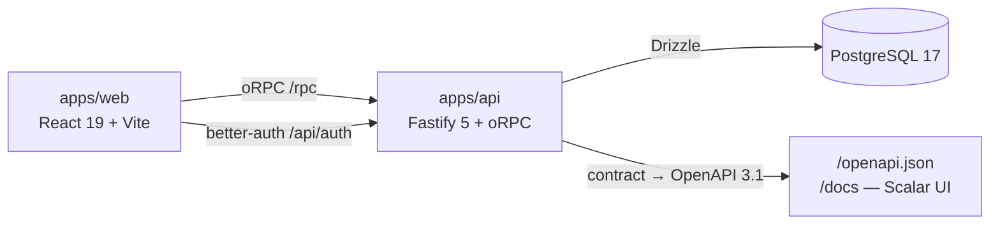

# Beautiful TodoApp

🇬🇧 **English** | [🇷🇺 Русский](README.ru.md)

A todo app built to production standards: a pnpm + Turborepo monorepo with **end-to-end type
safety from PostgreSQL rows to button props** — one zod/oRPC contract feeds the client, the server
and the generated OpenAPI. Auth, EN/RU localization, drag-and-drop ordering, three-state model,
coverage + mutation tests, CI gates and Lighthouse budgets. The legacy CRA prototype is kept
under the [`v0-legacy`](../../tree/v0-legacy) tag.

[](https://github.com/ramach05/Beautiful-todoApp/actions/workflows/ci.yml)
[](https://github.com/ramach05/Beautiful-todoApp/actions/workflows/lighthouse.yml)
[](LICENSE)
[](.nvmrc)
[](package.json)
[](packages/config/tsconfig/base.json)
[](#testing)
[-web%2077%20%C2%B7%20api%2090%20%C2%B7%20shared%2093-blue>)](#testing)

**Contents**: [Live demo](#live-demo) · [Screens](#screens) · [Highlights](#engineering-highlights) ·
[Features](#features) · [Architecture](#architecture) · [Stack & why](#stack--why) ·
[Auth & security](#auth--security) · [Performance](#performance) · [Testing](#testing) ·
[CI & releases](#ci--releases) · [Quick start](#quick-start) · [Development](#development) ·
[Trade-offs](#trade-offs--why-not-x) · [Roadmap](#roadmap) · [Author](#author)

## Live demo

> **Not deployed yet.** The deploy targets are already configured (web → Vercel,
> api → Railway, Postgres → Neon — see [Deploy](#deploy)); the links land here once
> the demo instance is up. Sign up in one click, or use the seed accounts:
> `demo@local.test` / `demo-pass-123` (3 starter todos) · `test_user@local.test` / `1234` (7 todos).

## Screens

The whole flow — sign up, CRUD, filters, reorder, sign out — in one recording:


| **Todo list**                                                                        | **Stats**                                                                                  | **Settings**                                                                                    |
| ------------------------------------------------------------------------------------ | ------------------------------------------------------------------------------------------ | ----------------------------------------------------------------------------------------------- |
| [](docs/screenshots/desktop/todo.png) | [](docs/screenshots/desktop/stats.png)         | [](docs/screenshots/desktop/settings.png)     |
| **Sign in**                                                                          | **Sign up**                                                                                | **RU locale**                                                                                   |
| [](docs/screenshots/desktop/login.png) | [](docs/screenshots/desktop/register.png) | [](docs/screenshots/desktop/ru.png)                |
| **Mobile · todo**                                                                    | **Mobile · stats**                                                                         | **Mobile · sign up**                                                                            |
| [](docs/screenshots/mobile/todo.png) | [](docs/screenshots/mobile/stats.png)    | [](docs/screenshots/mobile/register.png) |

Two micro-recordings — drag-and-drop ordering and the EN ⇄ RU switch:

| **Drag to reorder**                                                      | **EN ⇄ RU locale**                                                                         |
| ------------------------------------------------------------------------ | ------------------------------------------------------------------------------------------ |
| [](docs/screenshots/reorder.gif) | [](docs/screenshots/locale-switch.gif) |

Every shot is captured by `node scripts/capture-screenshots.mjs` (prod builds, real api,
scripted user flows) — see the [screenshots checklist](docs/screenshots/README.md).

## Engineering highlights

- **One contract, three consumers.** The zod + oRPC contract in `packages/shared` is the single
  source of truth: the client gets typed calls with typed errors (no codegen), the server is
  checked against the same contract, and OpenAPI 3.1 + a Scalar UI at `/docs` are generated from
  it. Hand-editing types on either side is impossible by construction. → [Architecture](#architecture)
- **FSD boundaries are linted, not documented.** [steiger] + ESLint enforce layer direction,
  public APIs and slice isolation on every PR (`pnpm fsd:check`), and the state split is pinned:
  server data in TanStack Query, client state in Effector, filter/search in the URL
  — [ADR-0002](docs/adr/0002-state-management.md).
- **Auth as a product feature with a written threat model.** httpOnly session cookies survive a
  reload; every auth POST is rate-limited; `X-Forwarded-For` is trusted only from a CIDR list;
  brute force, CSRF and email probing are addressed in a table —
  [ADR-0004](docs/adr/0004-auth-better-auth.md).
- **UX details with a measured cost.** All motion runs on one rAF loop (cursor spotlight,
  parallax) plus CSS (stagger, view transitions, tooltips) and switches off for touch and
  `prefers-reduced-motion`. The background photo ships as AVIF/WebP with a blur-up LQIP and a
  viewport-matched `preload`: 458 KB JPEG → 159 KB AVIF.
- **Filter and search are URL state.** `/?filter=active&q=text` survives reload, is shareable and
  back-button friendly; junk query params collapse to defaults.
- **Every new account gets starter todos via database hooks**, not a client-side hack: the default
  list is issued by better-auth's `databaseHooks` inside the same transaction as user creation.
- **Quality has ratchets, not intentions.** Coverage thresholds fail the build; nightly Stryker
  runs with a `break` score for the contract package; Lighthouse budgets fail the PR; axe checks
  six screens on desktop and mobile.

## Features

- sign up / sign in (email + password), session in an httpOnly cookie, survives reload;
- todos: create, complete, flag important, delete, **manual drag-and-drop order** (mouse and
  keyboard, order persisted in Postgres), search and All / Active / Done filters;
- `/stats`: aggregate cards + a 7-day completion SVG chart, loaded as a separate lazy chunk with
  the data prefetched by the router loader;
- `/settings`: change email and password, sign out everywhere, delete the account (confirm modal);
- **EN/RU UI**: the language lives on the user profile, arrives with the session and applies before
  the first paint — a Russian user gets Russian on any device;
- data isolated per owner — everyone sees only their own todos;
- responsive layout, a11y-checked screens, state in PostgreSQL.

## Architecture



```
apps/web        SPA on Feature-Sliced Design (see below)
apps/api        Fastify: oRPC router, better-auth, OpenAPI/Scalar docs, Drizzle migrations + seed
packages/shared zod contracts and types — the single source for web and api
packages/config shared eslint/typescript/prettier configs
e2e             Playwright user flows + axe checks on production builds
docs/adr        architecture decision records
scripts         one-command dev startup, image pipeline
```

`apps/web` follows FSD v2 (~110 files): `app` (composition root, routes) → `pages` →
`widgets` (layout, city background) → `features` (auth, locale, todo add/filter/reorder/stats) →
`entities/todo` (types, Query hooks, `TodoItem`) → `shared` (api client, i18n, mocks, ui, styles).
Rules steiger enforces: imports only down the layers; no cross-slice imports; a slice is imported
only through its public `index.ts`; server state in `entities/*/model`, client state in
`features/*/model`, filter/search in route params. Exceptions are only targeted and motivated
(`apps/web/steiger.config.ts`).

- The session boundary is a `SessionResolver` interface: production is better-auth, the dev mock
  is a fixed demo user; every procedure is authorized and the repository takes `userId` explicitly.
- Without a running backend the web app works on an in-process oRPC mock (`VITE_USE_MOCKS=1`) —
  it is lazy-imported and tree-shaken out of the production bundle.

## Stack & why

| Choice                                           | Why                                                                                                                                                               |
| ------------------------------------------------ | ----------------------------------------------------------------------------------------------------------------------------------------------------------------- |
| **React 19 + Vite**, not Next.js                 | Everything lives behind an auth wall; there is nothing to index, and the SPA fits the Lighthouse budget. [Why](#trade-offs--why-not-x)                            |
| **oRPC + zod**, not REST + codegen               | One contract types client, server and errors without a codegen step; OpenAPI is generated from it for free — [ADR-0003](docs/adr/0003-orpc-contract.md)           |
| **TanStack Query / Effector / URL**, three homes | each kind of state has exactly one owner — [ADR-0002](docs/adr/0002-state-management.md)                                                                          |
| **better-auth**, not hand-rolled JWT             | sessions, email change, account deletion and locale-as-additional-field out of the box; the token model is still reviewable and small                             |
| **Drizzle + PostgreSQL 17**                      | typed schema and migrations that match the contract-first style of the rest of the repo                                                                           |
| **Tailwind 4**                                   | design lives in the components; shared tokens as CSS variables                                                                                                    |
| **pnpm workspaces + Turborepo**                  | four packages with real build order (`shared → api/web`); turbo caches lint/typecheck/test across them                                                            |
| **Vitest + PGlite + in-process oRPC mock**       | api tests run a real Postgres and the real Fastify app in milliseconds, with no docker; e2e uses real builds — [ADR-0005](docs/adr/0005-e2e-production-builds.md) |
| **i18next with typed keys**                      | a wrong key is a compile error; ru/en parity is a test — [ADR-0006](docs/adr/0006-i18n-react-i18next.md)                                                          |
| **@dnd-kit + a `position` column**               | pointer + keyboard sensors, optimistic reorder persisted server-side — [ADR-0007](docs/adr/0007-dnd-kit-reorder.md)                                               |
| **release-please**                               | conventional commits → release PR → tag + GitHub Release; the changelog is never written by hand                                                                  |

## Auth & security

The full threat table is [ADR-0004](docs/adr/0004-auth-better-auth.md); the shape of it:

- session token in an **httpOnly `SameSite` cookie** — JS cannot read it, XSS cannot exfiltrate it;
- **rate limit on every auth POST** (default 20/min per IP), Fastify answers 429 before better-auth;
- **`trustProxy` by CIDR**: `X-Forwarded-For` is honored only from the listed proxy addresses, so a
  client cannot spoof the rate-limit key;
- login against a nonexistent email is indistinguishable by response (better-auth), so it leaks nothing;
- **`/health`** is liveness, **`/readyz`** pings Postgres so a load balancer can eject a broken instance;
- helmet headers, HSTS in production, request-id propagated end-to-end for correlating FE/BE logs;
- `/docs` and `/openapi.json` are public on purpose: they expose only the shape of our own rpc
  contract, and every procedure answers 401 without a session.

Honest scope: it is a demo-scale app, not a payment service — `minPasswordLength: 4` for
frictionless demos, the rate-limit counter is per-process memory, CSP is off so the bundled Scalar
UI can run. The full list is in [SECURITY.md](SECURITY.md).

## Performance

Lighthouse CI runs on every PR against hard budgets — mobile emulation, simulated throttling,
median of 3 runs (measured on Apple Silicon with headroom for CI runners, not pulled from thin air):

| Metric                   | Fact     | Budget     |
| ------------------------ | -------- | ---------- |
| Performance (score)      | 0.87     | ≥ 0.80     |
| First Contentful Paint   | 2 480 ms | ≤ 3 500 ms |
| Largest Contentful Paint | 3 180 ms | ≤ 4 500 ms |
| Cumulative Layout Shift  | 0.004    | ≤ 0.05     |
| Total Blocking Time      | 0 ms     | ≤ 500 ms   |
| Transferred over network | 460 KB   | ≤ 700 KB   |

- JS is split into cacheable chunks: app entry 281 KB raw (90 KB gz), `vendor-react` 65 KB gz,
  `vendor-tanstack` 35 KB gz, `vendor-dnd` 20 KB gz, `vendor-effector` 9 KB gz; the `/stats` page
  is a 1.4 KB gz lazy chunk fetched under a Suspense skeleton while the router loader prefetches its data.
- Sentry ships as zero bytes until `VITE_SENTRY_DSN` is set — without a DSN the branch is
  tree-shaken at build time.
- Background photo: AVIF/WebP `srcset`, blur-up LQIP, `preload` of the width-matched variant;
  the decorative image is excluded from LCP by design, the LCP candidate is the heading text.
- Optimistic mutations update the list before the server responds; reorder is optimistic too.

## Testing

```
57 Vitest tests — web 32 (RTL + in-process oRPC mock) · api 11 (real Fastify app on in-process PGlite) · shared 14 (contracts)
13 Playwright flows — full CRUD + filters + reorder + a11y (axe, 6 screens × desktop/mobile)
                    + account flows: email/password change, sign out everywhere, account deletion, locale persistence
```

| Package | lines (measured) | CI floor (lines) |
| ------- | ---------------- | ---------------- |
| web     | 77%              | 65%              |
| api     | 90%              | 80%              |
| shared  | 93%              | 85%              |

- e2e runs on **production builds** against a dedicated Postgres database that is recreated on
  every run, plus a second mobile-viewport pass of the core flow — [ADR-0005](docs/adr/0005-e2e-production-builds.md).
- **Mutation testing** (Stryker) runs nightly: the contract package fails below a 70% mutation
  score (76% now); the api repository layer is measured for trend.
- Tests in mutable packages stay flat (no `describe`) — Stryker's per-test filter with vitest 5
  does not see nested tests, and mutants survive.

## CI & releases

- **On every PR** (both required to merge into `main`): `quality` — prettier, ESLint, tsc,
  coverage-thresholded Vitest, prod builds, steiger; `e2e` — Playwright on prod builds with a
  Postgres service container. Plus `lighthouse` against the budgets above.
- **Nightly**: Stryker mutation runs, reports as artifacts.
- **On merge to `main`**: release-please opens a release PR (changelog + version from conventional
  commits); merging it cuts the tag and the GitHub Release. One version for the whole monorepo —
  the packages are private and always ship as one artifact.
- Commits and PR hygiene: husky pre-commit (lint-staged) + commitlint; PR/issue templates in `.github/`.

## Quick start

Requires Node 24 (`nvm use`) and Docker.

```bash
pnpm install
pnpm start            # creates .env files, starts postgres, resets + migrates + seeds the dev db
                      # web http://localhost:5173, api http://localhost:3001
```

> **`pnpm start` resets the dev database to seed state on every launch** — an intentional dev
> convenience: a run never depends on leftovers from the previous one. Need persistent data? Use
> the manual sequence below; `pnpm dev` never resets anything:

```bash
cp apps/api/.env.example apps/api/.env
cp apps/web/.env.example apps/web/.env
pnpm db:up                                # postgres:17 on 5433
pnpm --filter @bt/api db:migrate
pnpm --filter @bt/api db:seed
pnpm dev                                  # web 5173, api 3001, no reset
```

Seed accounts: `demo@local.test` / `demo-pass-123` and `test_user@local.test` / `1234`. Every newly
registered user gets the same 3 starter todos. If 5173 is busy, Vite picks the next free port and
the dev api accepts any localhost origin — no `CORS_ORIGIN` edits needed.

Want the frontend without any backend? Keep `VITE_USE_MOCKS=1` in `apps/web/.env` — the app runs on
the in-process mock with a demo session. API docs after startup: [`/docs`](http://localhost:3001/docs)
(Scalar) and [`/openapi.json`](http://localhost:3001/openapi.json).

## Development

| Command              | What it does                                                           |
| -------------------- | ---------------------------------------------------------------------- |
| `pnpm lint`          | ESLint across all packages (`--max-warnings=0`)                        |
| `pnpm fsd:check`     | steiger: FSD structure and import direction in `apps/web`              |
| `pnpm typecheck`     | `tsc --noEmit` across all packages                                     |
| `pnpm test`          | Vitest: web (RTL) + api (PGlite) + shared                              |
| `pnpm test:coverage` | the same with v8 coverage — CI runs this, thresholds enforce a ratchet |
| `pnpm build`         | production builds of web and api                                       |
| `pnpm test:e2e`      | Playwright on prod builds (needs Docker)                               |
| `pnpm mutation`      | Stryker mutation testing (shared + api)                                |
| `pnpm lighthouse`    | Lighthouse CI against the budgets (build web with mocks first)         |

Pre-commit runs lint-staged; commit messages are checked by commitlint (Conventional Commits).
Environment variables: `apps/api` — `DATABASE_URL`, `HOST`, `PORT`, `CORS_ORIGIN`, `BETTER_AUTH_URL`,
`BETTER_AUTH_SECRET` (required in production), `AUTH_RATE_LIMIT_MAX`, `TRUST_PROXY`, `SENTRY_DSN`;
`apps/web` — `VITE_API_URL`, `VITE_AUTH_URL`, `VITE_USE_MOCKS`, `VITE_SENTRY_DSN`
(examples in `.env.example` files).

### Deploy

- **Web → Vercel**: root directory `apps/web` (`vercel.json` adds SPA rewrites); envs
  `VITE_API_URL=https://<api-host>/rpc`, `VITE_AUTH_URL=https://<api-host>/api/auth`.
- **API → Railway**: Dockerfile build (multi-stage, `pnpm deploy`, runs as `node`), healthcheck
  on `/health`; envs `DATABASE_URL` (Neon, pooled), `BETTER_AUTH_SECRET`, `CORS_ORIGIN`,
  `TRUST_PROXY` (see [Auth & security](#auth--security) for why `TRUST_PROXY` matters).
- **DB → Neon**: pooled string for the app, direct for migrations.
- **Sentry** (optional): `SENTRY_DSN` / `VITE_SENTRY_DSN`; without them Sentry is not in the bundle at all.

## Trade-offs & why not X

Not here on purpose. The scale is a pet project: one api instance, demo data, one user per tab;
each point says why the chosen solution is sufficient and what would change my mind.

- **Redis / external cache.** Sessions hit a Postgres index, server data is cached client-side by
  TanStack Query, and the rate-limit counter lives in process memory. Redis arrives with the
  second api instance: an in-memory counter stops seeing all requests.
- **WebSocket / realtime.** Todos are edited by the person reading them, and optimistic mutations
  show the result before the server answers. Realtime is needed when a second user joins a shared list.
- **SSR / Next.js.** The whole app is behind an auth redirect; there are no pages to index and the
  first render fits the budget. SSR would add a server runtime and a cache layer for pages nobody finds in search.
- **Microservices / Kubernetes.** One Fastify process with clear seams (`router.ts`, `repo.ts`,
  `SessionResolver`) builds into one container and runs with one command. Splitting pays off when
  parts get a different release cadence and failure cost — that arrives with several teams.
- **Storybook.** The UI primitives are few and all visible on five pages in real Query states. A
  separate catalog means separate data and separate scenarios to babysit.
- **GraphQL.** The oRPC contract gives the same type guarantees without codegen, resolvers and
  depth limits. GraphQL earns its keep when third-party clients need a server-side schema.
- **OAuth providers.** better-auth plugs them in, but they need external secrets and developer
  accounts; email+password covers "come in and look around".
- **PWA / offline.** The data lives in a database that cannot answer without a network, and a
  service worker would add an asset cache to invalidate before every release.

## Roadmap

- host the live demo (Vercel + Railway + Neon — configs already in the repo)
- raise the coverage floors as the web floor climbs from 65%
- split the login flow into its own lazy chunk (initial JS is one chunk's work away from per-route)
- k6/autocannon smoke load report for the api
- OAuth via a better-auth plugin (when there is a service worth plugging)

## Documentation

- [ADRs](docs/adr) — why the stack and boundaries are exactly these (7 records, English with Russian mirrors).
- [Image licenses](docs/image-licenses.md) — the background photo: origin, CC0 license, reproducible regeneration.
- [Screenshot checklist](docs/screenshots/README.md) — capture plan for this README's galleries.
- [Contributing](CONTRIBUTING.md) · [Security policy](SECURITY.md) · commit rules (commitlint) and PR/issue templates in `.github/`.

## License

[MIT](LICENSE)

## Author

**Roman Kovalenko** — solo author: product, architecture, frontend (React / FSD / motion),
backend (Fastify / Drizzle / auth), tests and CI.

[github.com/ramach05](https://github.com/ramach05) · [linkedin.com/in/ramach05](https://linkedin.com/in/ramach05)

[steiger]: https://github.com/feature-sliced/steiger
