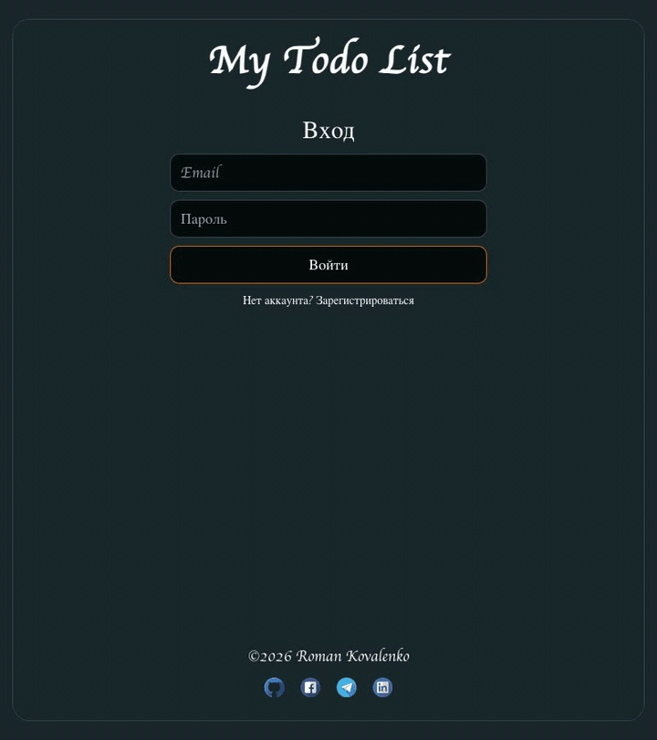
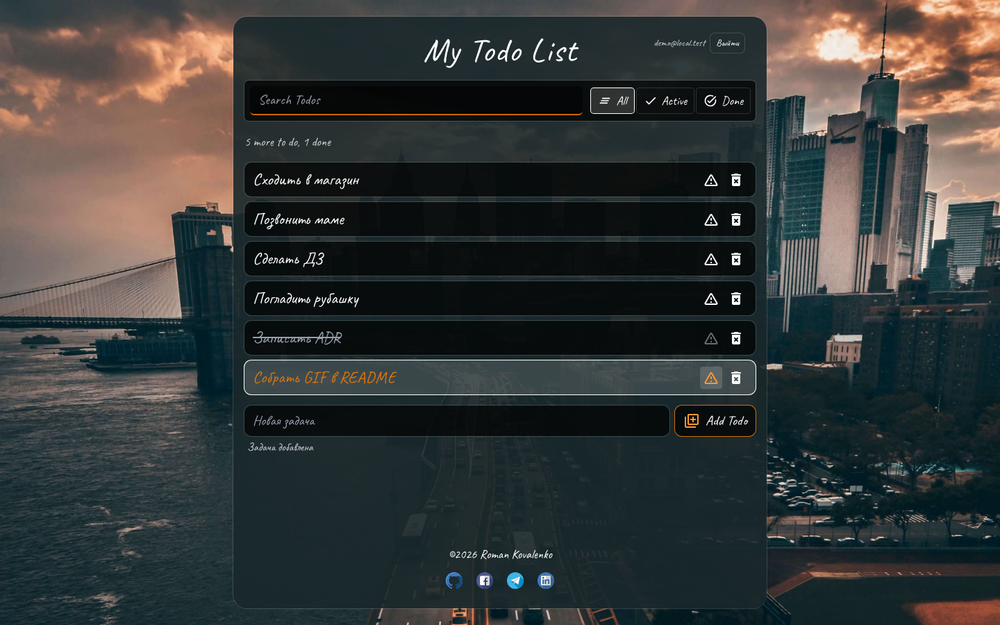
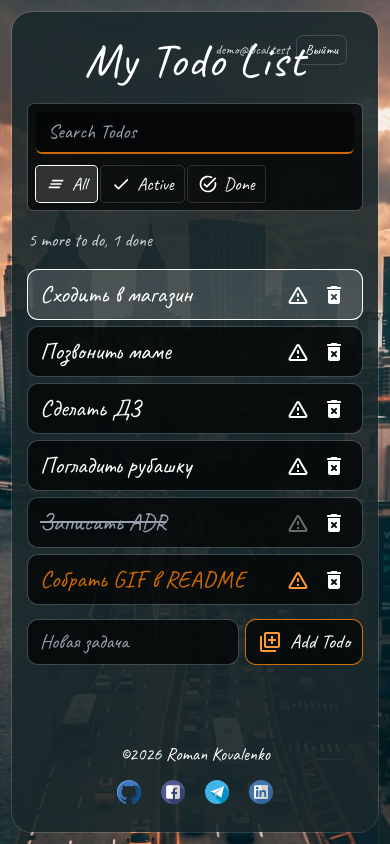
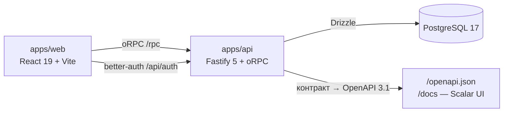

# Beautiful TodoApp


Todo-приложение уровня production: монорепо, сквозная типобезопасность от БД до кнопок в UI, авторизация, тесты, CI, наблюдаемость. Legacy-CRA-версия сохранена под тегом [`v0-legacy`](../../tree/v0-legacy).



## Возможности

- регистрация и вход (email + пароль), сессия в httpOnly-cookie, переживает перезагрузку;
- задачи пользователя: создание, завершение, приоритет, удаление, поиск и фильтры (All / Active / Done);
- фильтр и поиск — часть адреса (`/?filter=active&q=текст`): ссылка переживает перезагрузку и отправляется другому человеку, «назад» работает, а мусор в адресе схлопывается до значений по умолчанию;
- `/stats`: агрегаты (всего, активных, выполнено, важных), SVG-график выполнения за 7 дней и самое старое незавершённое; страница грузится отдельным lazy-чанком, а данные дотягиваются до рендера;
- `/settings`: смена email и пароля, выход на всех устройствах, удаление аккаунта;
- данные изолированы по владельцу — каждый видит только свои задачи;
- адаптивная вёрстка, фон — фото ночного города по лицензии CC0, a11y-проверка всех экранов на desktop и mobile, состояние в PostgreSQL.

|                                           |                                               |
| ----------------------------------------- | --------------------------------------------- |
|  |  |

## Стек

| Слой          | Технологии                                                                                                                                             |
| ------------- | ------------------------------------------------------------------------------------------------------------------------------------------------------ |
| Frontend      | React 19, Vite 8, TypeScript 6, TanStack Router/Query, Effector, Tailwind 4                                                                            |
| Backend       | Node.js 24, Fastify 5, oRPC, Drizzle ORM, PostgreSQL 17                                                                                                |
| Auth          | better-auth (email+password, httpOnly cookie); `@fastify/rate-limit` на auth-POST, `@fastify/helmet`, trust-proxy по CIDR-списку                       |
| Контракт      | zod-схемы в `packages/shared` — один источник типов для клиента и сервера; из него же генерируются OpenAPI 3.1 (`/openapi.json`) и Scalar UI (`/docs`) |
| Качество      | Vitest, Testing Library, Playwright + axe-core, Stryker, ESLint, Prettier, Lighthouse CI, GitHub Actions, Renovate                                     |
| Наблюдаемость | Sentry (env-gated), request-id сквозной FE→BE                                                                                                          |
| Релизы        | release-please: conventional commits → релизный PR, тег и GitHub Release                                                                               |

## Архитектура



- Серверное состояние — TanStack Query (оптимистичные мутации с откатом), состояние-ссылка (фильтр, поиск) — search-параметры роута, остальное клиентское (сессия, команды аккаунту) — Effector: [ADR-002](./docs/adr/0002-state-management.md).
- oRPC-контракт из `@bt/shared` типизирует и клиент, и сервер, включая ошибки авторизации; тот же контракт описывает in-process мок и служит источником OpenAPI 3.1 с интерактивными docs на `/docs` (Scalar, локальные ассеты, без CDN): [ADR-003](./docs/adr/0003-orpc-contract.md).
- Ленивая загрузка — на примере `/stats`: чанк страницы грузится под `Suspense`-скелетон, router-loader дотягивает данные до рендера, `QueryClient` один на приложение: его используют и загрузчик данных роута, и компоненты.
- Без запущенного бэкенда web работает на in-process моке (`VITE_USE_MOCKS=1`) с фиксированной демо-сессией.
- Граница сессии — интерфейс `SessionResolver`: прод — better-auth, мок — демо-пользователь; каждая процедура авторизованная, репозиторий получает `userId` явным аргументом.
- Угрозы и контрмеры авторизации (подбор пароля, `X-Forwarded-For`, CSRF, разведка email) разобраны таблицей в [ADR-004](./docs/adr/0004-auth-better-auth.md).
- Фон — fixed-слой (его размер не зависит от высоты списка, поэтому картинка не «дёргается»): AVIF/WebP по `srcset`, LQIP-плейсхолдер с blur-up, `preload` варианта, подходящего по ширине вьюпорта; JPEG 458 КБ → AVIF 159 КБ. Лицензия и происхождение — в [docs/image-licenses.md](./docs/image-licenses.md).
- Анимации — CSS и один rAF-цикл на spotlight и параллакс, без библиотек: stagger появления первых строк, hover-lift, view transitions между роутами. Всё выключается на тач-устройствах и по `prefers-reduced-motion`.

```
apps/web        SPA на Feature-Sliced Design (см. ниже)
apps/api        Fastify: oRPC-роутер, better-auth, OpenAPI/Scalar docs, Drizzle-миграции и сид
packages/shared zod-контракты и типы, общие для web и api
packages/config общие конфиги eslint/typescript/prettier
e2e             Playwright-сценарии и a11y-проверки на прод-сборках
docs/adr        архитектурные решения (ADR)
scripts         dev-запуск одной командой, оптимизация изображений
```

### Структура frontend: Feature-Sliced Design

`apps/web` построен по FSD v2; связи и структура проверяются линтером steiger — `pnpm fsd:check` (входит в CI-quality):

| Слой        | Содержимое                                                                                                                                                                    |
| ----------- | ----------------------------------------------------------------------------------------------------------------------------------------------------------------------------- |
| `app/`      | composition root: `main.tsx`, провайдеры, observability, `routes/` — `/`, `/login`, `/register`, `/stats`, `/settings`, 404                                                   |
| `widgets/`  | каркасы страниц: `layout` (header с навигацией, footer, shell, city-background)                                                                                               |
| `features/` | пользовательские действия: `auth` (сессия и действия аккаунта), `todo-add`, `todo-filter` (схема search-параметров), `todo-stats` (агрегация и график)                        |
| `entities/` | доменные объекты: `todo` (типы, Query-хуки, `TodoItem`)                                                                                                                       |
| `pages/`    | страницы: todo / login / register / stats / settings                                                                                                                          |
| `shared/`   | фундамент: `api` (oRPC-клиент и QueryClient), `lib` (`cn`, `pointer-ambient`), `mocks` (in-process oRPC-мок для dev/тестов), `ui` (`assets`, `spinner`, `skeleton`), `styles` |

Правила, которые соблюдает код и за которыми следит steiger:

- импорт направлен только вниз по слоям (`app` → … → `shared`);
- слайсы одного слоя не импортируют друг друга (cross-imports запрещены);
- слайс импортируется только через public API — `index.ts` этого слайса;
- слои в путях видны через алиас `@/*` (→ `apps/web/src/*`), относительные импорты — только внутри слайса;
- серверное состояние (Query) живёт в `entities/*/model`, клиентское (Effector) — в `features/*/model`, фильтры и поиск — в URL роута — [ADR-002](./docs/adr/0002-state-management.md);
- dev-мок oRPC лежит в `shared/mocks` и подгружается лениво — в прод-бандл не попадает; интеграционные тесты (`tests/`) живут вне `src` и не являются кодом продукта.

Исключения из правил — только точечные и мотивированные, зафиксированы в `apps/web/steiger.config.ts`.

## Быстрый старт

Требуется Node.js 24 (`nvm use`) и Docker.

```bash
pnpm install
pnpm start            # сам создаст .env, поднимет postgres, применит миграции и сид
                      # web http://localhost:5173, api http://localhost:3001
```

> **`pnpm start` каждый запуск сбрасывает dev-БД к сид-состоянию**: `db:reset` снимает схемы `public` и `drizzle`, затем идут миграции и сид. Все локальные задачи удаляются, демо-аккаунты создаются заново. Это осознанное dev-удобство: результат прогона не зависит от того, что осталось в volume с прошлого раза. Нужны сохранённые данные между запусками — используйте ручной запуск ниже: `pnpm dev` ничего не сбрасывает.

Ручной запуск по шагам:

```bash
cp apps/api/.env.example apps/api/.env
cp apps/web/.env.example apps/web/.env
pnpm db:up                                # postgres:17 на 5433
pnpm --filter @bt/api db:migrate          # чистый старт: сначала db:reset, он снимает схемы public и drizzle
pnpm --filter @bt/api db:seed
pnpm dev                                  # web 5173, api 3001, без сброса данных
```

В `apps/web/.env` можно оставить `VITE_USE_MOCKS=1` — тогда web работает совсем без бэкенда и БД (демо-сессия включается автоматически). Для полноценной работы с api выставьте `VITE_USE_MOCKS=0`.

Если `http://localhost:5173` занят другим приложением, Vite сам возьмёт следующий свободный порт (`5174`, `5175`, …). В dev api принимает любой `localhost`-порт — править `CORS_ORIGIN` не нужно; строгий whitelist из `CORS_ORIGIN` действует только в production.

Документация API после запуска: `http://localhost:3001/docs` (Scalar) и `http://localhost:3001/openapi.json`.

Демо-аккаунты (сид): `demo@local.test` / `demo-pass-123` и тестовый `test_user@local.test` / `1234`.

## Проверки

| Команда           | Что делает                                                                                                                      |
| ----------------- | ------------------------------------------------------------------------------------------------------------------------------- |
| `pnpm lint`       | ESLint по всем пакетам                                                                                                          |
| `pnpm fsd:check`  | steiger: структура и импорты FSD в `apps/web`                                                                                   |
| `pnpm typecheck`  | tsc по всем пакетам                                                                                                             |
| `pnpm test`       | Vitest: web (RTL) и api (PGlite)                                                                                                |
| `pnpm build`      | прод-сборки web и api                                                                                                           |
| `pnpm test:e2e`   | Playwright на прод-сборках: CRUD-сценарий с изоляцией данных и a11y (axe-core) на desktop и mobile; нужен Docker и `pnpm build` |
| `pnpm mutation`   | Stryker: мутационное тестирование `shared` и `api`                                                                              |
| `pnpm lighthouse` | Lighthouse CI поверх прод-сборки web против бюджетов производительности                                                         |

CI (`quality` + `e2e`) прогоняет это на каждом PR; обе проверки обязательны для merge в `main`.

Мутационный прогон (`@stryker-mutator/vitest-runner`) добавлен отдельным ночным workflow
`.github/workflows/mutation.yml`: пороги выставлены без `break`, поэтому он только публикует артефакт-отчёт.
Тесты в мутабельных пакетах (`packages/shared`, `apps/api`) не оборачивают в `describe`: per-test фильтр
Stryker с vitest 5 такие тесты не находит, и мутанты остаются живыми.

### Бюджеты производительности (Lighthouse CI)

Профиль — мобильная эмуляция с симулированным троттлингом (профиль Lighthouse по умолчанию), 3 прогона, сравнение по медиане. Замеры — на Apple Silicon; бюджеты — это фактические значения с запасом на более слабый CI-раннер, а не «с потолка»:

| Метрика                  | Факт     | Бюджет     |
| ------------------------ | -------- | ---------- |
| Performance (score)      | 0.89     | ≥ 0.80     |
| First Contentful Paint   | 2 490 мс | ≤ 3 500 мс |
| Largest Contentful Paint | 3 260 мс | ≤ 4 500 мс |
| Cumulative Layout Shift  | 0.003    | ≤ 0.05     |
| Total Blocking Time      | 0 мс     | ≤ 500 мс   |
| Передано по сети         | 471 КБ   | ≤ 700 КБ   |

LCP-кандидатом остаётся текст заголовка: фоновое фото декоративное (`alt=""`), поэтому в LCP не участвует, а `preload` и AVIF нужны, чтобы первый кадр не был пустым. Замер идёт на прод-сборке со стабильным in-process моком, ассеты отдаёт встроенный сервер LHCI, поэтому бюджет проверяет рендер и вес ассетов, а не прод-данные и не api. Workflow `lighthouse.yml` падает при нарушении бюджета и всегда отдаёт отчёт артефактом; блокирующей проверкой при merge он не объявлен, пока не добавлен в branch protection.

Локально перед прогоном нужен собранный web с моками: `VITE_USE_MOCKS=1 pnpm build && pnpm lighthouse`. В workflow это делает шаг сборки со своим `VITE_USE_MOCKS`.

## Почему здесь нет X

Этого нет в приложении намеренно. Масштаб — пет-проект: один инстанс api, демо-данные, один пользователь в одной вкладке; в каждом пункте — почему выбранное решение достаточнее и что заставит передумать.

- **Redis и выносной кэш.** Сессию PostgreSQL отдаёт по индексу, серверные данные кэширует TanStack Query на клиенте, а счётчик rate-limit живёт в памяти процесса. Redis понадобится со второго инстанса api: in-memory счётчик перестанет видеть все запросы.
- **WebSocket / realtime.** Задачи меняет тот же человек, кто их читает, а оптимистичная мутация показывает результат до ответа сервера. Realtime понадобится при совместных списках, где задачу правит второй пользователь.
- **SSR и Next.js.** Всё приложение спрятано за проверкой авторизации в роутере, индексируемых страниц нет, а первый рендер укладывается в бюджет. SSR добавил бы серверный рантайм и слой кэшей ради страниц, которые никто не находит в поиске.
- **Микросервисы и Kubernetes.** Один Fastify-процесс с ясными границами (`router.ts`, `repo.ts`, `SessionResolver`) собирается в один контейнер и запускается одной командой. Разделять имеет смысл, когда у частей разный темп развития и разная цена отказа, а это появляется вместе с несколькими командами.
- **Storybook.** UI-примитивов немного, и все они видны на пяти страницах в реальных состояниях Query. Отдельный каталог — это ещё одни данные и ещё одни сценарии, за которыми надо следить.
- **i18n.** Язык интерфейса один, и второй не планируется; словарь под один язык — слой абстракции без выгоды. Добавлять, когда появится второй язык, а не про запас.
- **GraphQL.** Контракт oRPC даёт те же гарантии типов, но без кодогенерации, ресолверов и лимитов глубины запроса. GraphQL оправдан, когда к api подключаются чужие клиенты, которым нужна схема на стороне сервера.
- **OAuth-провайдеры.** better-auth подключает их плагином, но они требуют секретов и аккаунта разработчика у внешнего сервиса; email+пароль закрывает сценарий «войти и посмотреть».
- **PWA и offline.** Данные живут в БД и без сети не отдаются, а service worker добавил бы кэш ассетов, который нужно инвалидировать перед каждым релизом.

## Переменные окружения

`apps/api` (см. `apps/api/.env.example`): `DATABASE_URL`, `HOST`, `PORT`, `CORS_ORIGIN`, `BETTER_AUTH_URL`, `BETTER_AUTH_SECRET` (обязателен в production), `AUTH_RATE_LIMIT_MAX` (POST-запросы к auth на IP за минуту, дефолт 20), `TRUST_PROXY` (адреса/CIDR прокси через запятую; без него `X-Forwarded-For` не принимается), `SENTRY_DSN` (опционально).

`apps/web` (см. `apps/web/.env.example`): `VITE_API_URL`, `VITE_AUTH_URL`, `VITE_USE_MOCKS`, `VITE_SENTRY_DSN` (опционально).

## Деплой

- **Web → Vercel**: Root Directory — `apps/web` (конфиг `apps/web/vercel.json` включает SPA-ревайры). Envs: `VITE_API_URL=https://<api-host>/rpc`, `VITE_AUTH_URL=https://<api-host>/api/auth`.
- **API → Railway**: Docker-сборка из корня репозитория (Dockerfile `apps/api/Dockerfile`, Railpack/Dockerfile-сервис). Envs: `NODE_ENV=production`, `HOST=0.0.0.0`, `DATABASE_URL` (Neon, pooled), `BETTER_AUTH_URL=https://<api-host>`, `BETTER_AUTH_SECRET`, `CORS_ORIGIN=https://<web-host>`, `TRUST_PROXY=<адрес edge-прокси>`, при необходимости `AUTH_RATE_LIMIT_MAX`. Healthcheck: `GET /health`, Dockerfile указан в `railway.json`.
- **БД → Neon**: pooled-строку — приложению, direct — для миграций: `DATABASE_URL=<direct> pnpm --filter @bt/api db:migrate`.
- **Sentry** (по желанию): `SENTRY_DSN` / `VITE_SENTRY_DSN`; без переменных Sentry не загружается.
- `/docs` и `/openapi.json` открыты публично: наружу уходит только описание нашего rpc-контракта, без сессии все процедуры отвечают 401.

Demo: будет добавлено после деплоя.

## Релизы

Релизный цикл ведёт release-please: push в `main` запускает workflow, который собирает из conventional commits релизный PR (CHANGELOG + версия в корневом `package.json`), а после его merge — тег `v*` и GitHub Release. Конфиг — `.github/release-please-config.json`, версия одна на репозиторий: `apps/*` и `packages/*` — private-пакеты монорепо, они не публикуются отдельно и всегда едут одним артефактом. До 1.0 breaking-изменения поднимают minor, feat — patch (`bump-minor-pre-major`, `bump-patch-for-minor-pre-major`).

## Документация

- [ADR](./docs/adr) — почему стек и границы именно такие: monorepo, состояние, oRPC-контракт, auth с threat model, стратегия E2E.
- [Лицензии изображений](./docs/image-licenses.md) — происхождение и лицензия фонового фото, команда регенерации вариантов.
- Шаблоны PR/issue и правила коммитов (commitlint) — в `.github/` и `commitlint.config.js`; релизный цикл — в предыдущем разделе.
