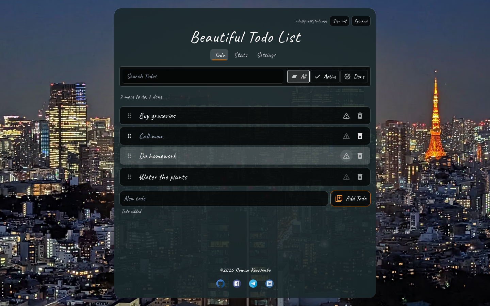
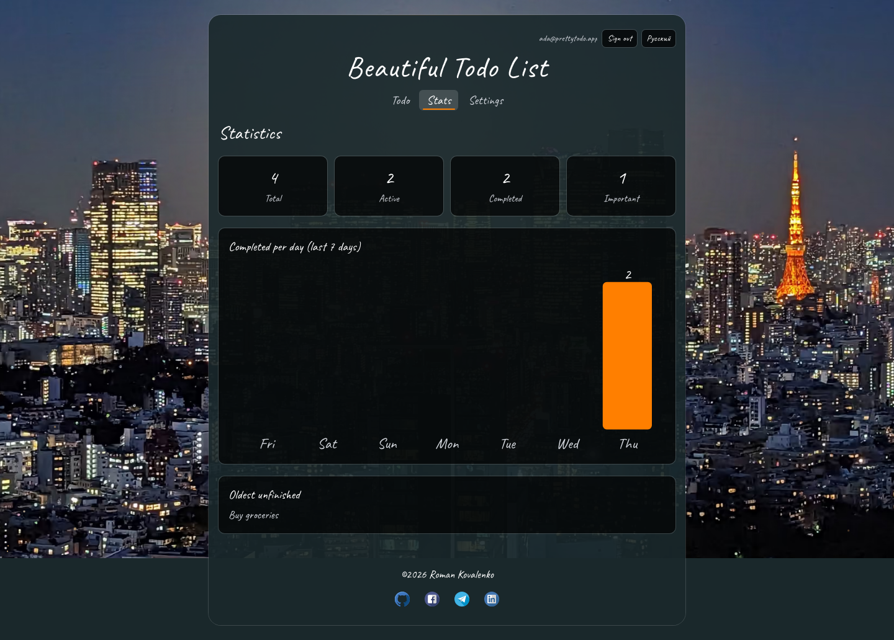
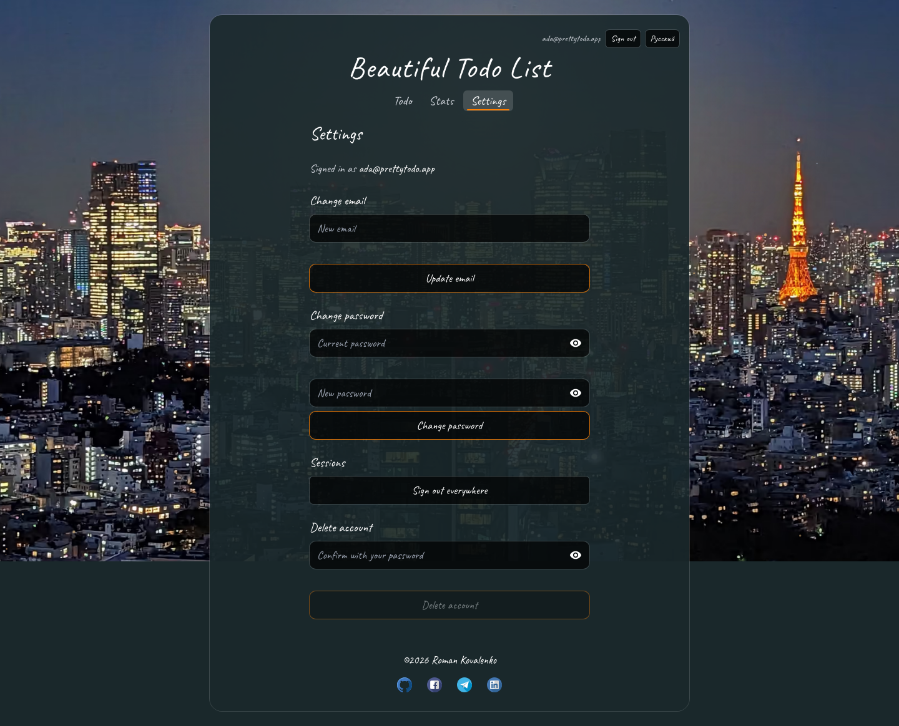
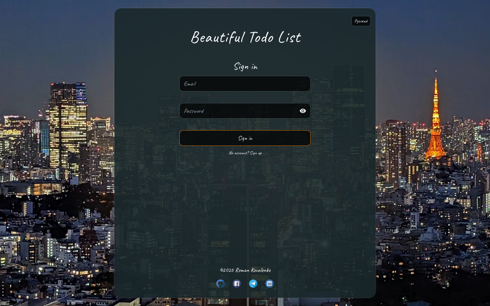
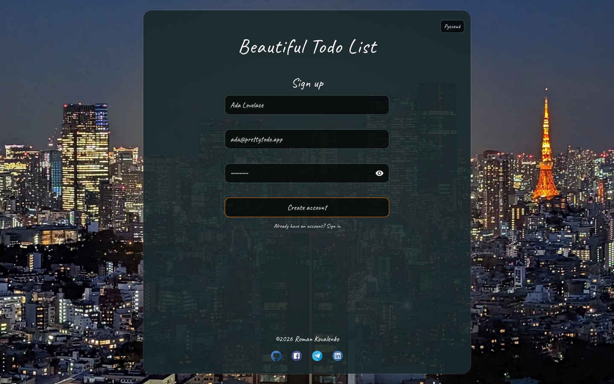
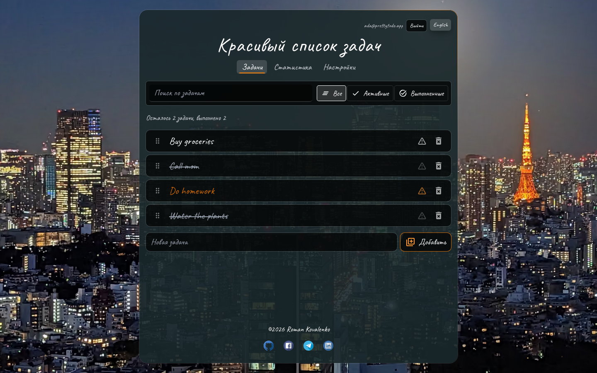
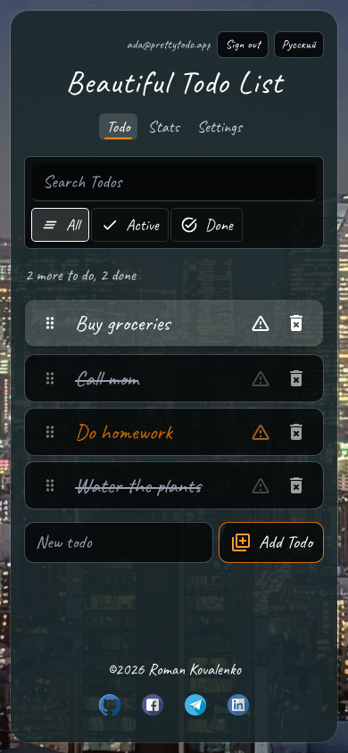
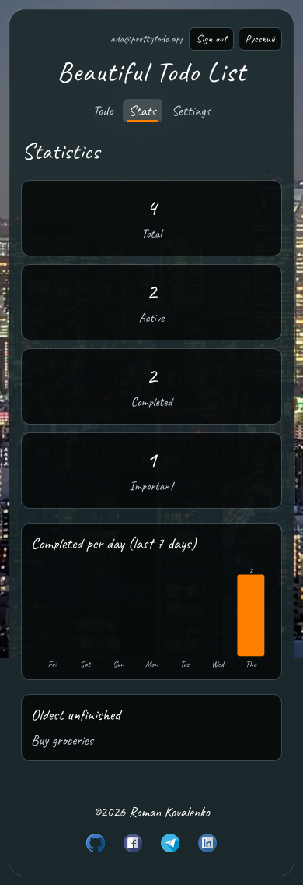
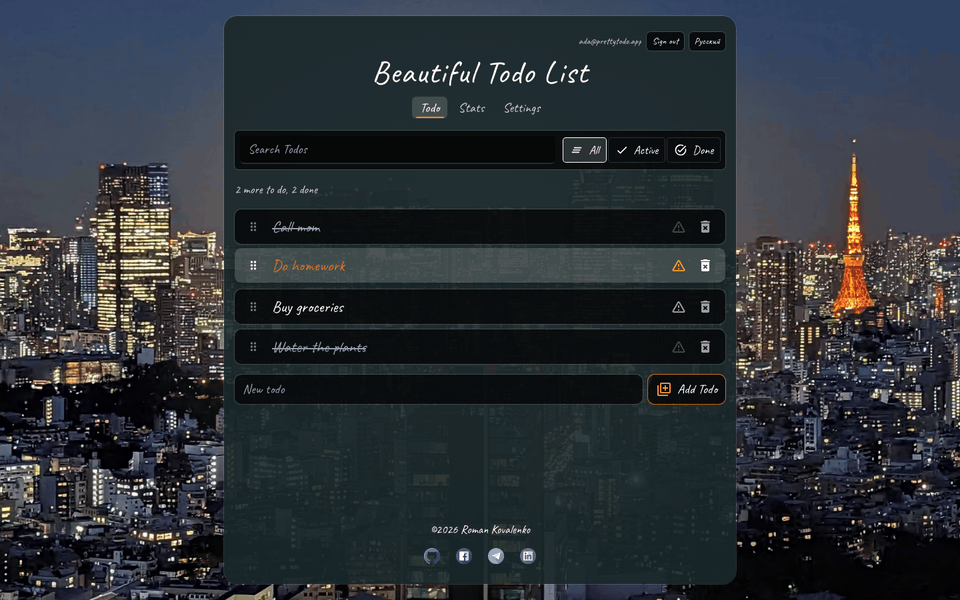
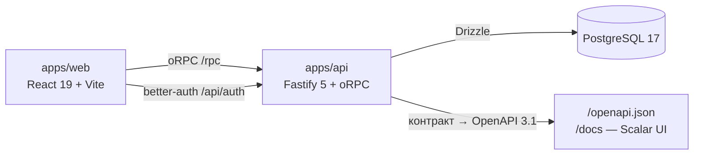

# Beautiful TodoApp

[🇬🇧 English](README.md) | **🇷🇺 Русский**

Todo-приложение уровня production: монорепо pnpm + Turborepo со **сквозной типобезопасностью от
строк PostgreSQL до пропсов кнопок** — один zod/oRPC-контракт питает клиент, сервер и генерируемый
OpenAPI. Авторизация, английская/русская локализация, drag-and-drop порядок, трёхмодельное
состояние, coverage и мутационные тесты, CI-гейты и бюджеты Lighthouse. Legacy-CRA-прототип
сохранён под тегом [`v0-legacy`](../../tree/v0-legacy).

[](https://github.com/ramach05/Beautiful-todoApp/actions/workflows/ci.yml)
[](https://github.com/ramach05/Beautiful-todoApp/actions/workflows/lighthouse.yml)
[](LICENSE)
[](.nvmrc)
[](package.json)
[](packages/config/tsconfig/base.json)
[](#тестирование)
[-web%2077%20%C2%B7%20api%2090%20%C2%B7%20shared%2093-blue>)](#тестирование)

**Содержание**: [Демо](#демо) · [Экраны](#экраны) · [Инженерные решения](#инженерные-хайлайты) ·
[Возможности](#возможности) · [Архитектура](#архитектура) · [Стек и почему](#стек--почему-именно-так) ·
[Auth и безопасность](#auth--безопасность) · [Производительность](#производительность) ·
[Тестирование](#тестирование) · [CI и релизы](#ci--релизы) · [Быстрый старт](#быстрый-старт) ·
[Разработка](#разработка) · [Trade-offs](#почему-здесь-нет-x) · [Roadmap](#roadmap) · [Автор](#автор)

## Демо

> **Ещё не задеплоено.** Цели деплоя уже настроены (web → Vercel, api → Railway,
> Postgres → Neon — см. [Деплой](#деплой)); ссылки появятся здесь, как только демо-инстанс
> заработает. Регистрация в один клик, либо сид-аккаунты:
> `demo@local.test` / `demo-pass-123` (3 стартовые задачи) · `test_user@local.test` / `1234` (7 задач).

## Экраны

Весь флоу — регистрация, CRUD, фильтры, перетаскивание, выход — одной записью:


| **Список задач**                                                                          | **Статистика**                                                                                  | **Настройки**                                                                                          |
| ----------------------------------------------------------------------------------------- | ----------------------------------------------------------------------------------------------- | ------------------------------------------------------------------------------------------------------ |
| [](docs/screenshots/desktop/todo.png)   | [](docs/screenshots/desktop/stats.png)         | [](docs/screenshots/desktop/settings.png)           |
| **Вход**                                                                                  | **Регистрация**                                                                                 | **Русская локаль**                                                                                     |
| [](docs/screenshots/desktop/login.png)         | [](docs/screenshots/desktop/register.png)  | [](docs/screenshots/desktop/ru.png)                  |
| **Мобильные · задачи**                                                                    | **Мобильные · статистика**                                                                      | **Мобильные · регистрация**                                                                            |
| [](docs/screenshots/mobile/todo.png) | [](docs/screenshots/mobile/stats.png) | [](docs/screenshots/mobile/register.png) |

Две микрозаписи — перетаскивание порядка и переключение EN ⇄ RU:

| **Перетаскивание**                                                              | **Переключение EN ⇄ RU**                                                                 |
| ------------------------------------------------------------------------------- | ---------------------------------------------------------------------------------------- |
| [](docs/screenshots/reorder.gif) | [](docs/screenshots/locale-switch.gif) |

Все кадры снимает `node scripts/capture-screenshots.mjs` (прод-сборки, настоящий api,
скриптованные пользовательские сценарии) — см.
[чек-лист скриншотов](docs/screenshots/README.ru.md).

## Инженерные хайлайты

- **Один контракт — три потребителя.** zod + oRPC-контракт в `packages/shared` — единый источник
  истины: клиент получает типизированные вызовы с типизированными ошибками без кодогенерации,
  сервер сверяется с тем же контрактом, а из него же генерируются OpenAPI 3.1 и Scalar UI на `/docs`.
  Разойтись типами на границе клиент/сервер невозможно по построению. → [Архитектура](#архитектура)
- **Границы FSD исполняются линтером, а не документом.** [steiger] + ESLint на каждом PR проверяют
  направление импортов, public API и изоляцию слайсов (`pnpm fsd:check`), а разделение состояния
  закреплено: серверные данные — TanStack Query, клиентское состояние — Effector, фильтр/поиск — URL
  — [ADR-0002](docs/adr/0002-state-management.ru.md).
- **Auth как продуктовая фича с описанной моделью угроз.** httpOnly-cookie сессия переживает
  перезагрузку; каждый auth-POST под rate limit; `X-Forwarded-For` принимается только из CIDR-списка;
  подбор пароля, CSRF и разведка email разобраны таблицей —
  [ADR-0004](docs/adr/0004-auth-better-auth.ru.md).
- **UX-детали с измеримой ценой.** Вся анимация живет на одном rAF-цикле (spotlight, параллакс)
  плюс CSS (stagger, view transitions, тултипы) и выключается на тач-устройствах и по
  `prefers-reduced-motion`. Фоновое фото приезжает как AVIF/WebP с blur-up LQIP и `preload`
  подходящего варианта: 458 КБ JPEG → 159 КБ AVIF.
- **Фильтр и поиск — состояние URL.** `/?filter=active&q=текст` переживает перезагрузку,
  пересылается ссылкой и дружит с кнопкой «назад»; мусор в query схлопывается до значений по умолчанию.
- **Каждый новый аккаунт получает стартовые задачи через database hooks**, а не клиентским
  извращением: список выдается `databaseHooks` better-auth в той же транзакции, что и создание пользователя.
- **У качества храповик, а не намерения.** Coverage-пороги валят сборку; ночной Stryker с
  `break`-порогом для пакета контрактов; бюджеты Lighthouse валят PR; axe проверяет шесть
  экранов на desktop и mobile.

## Возможности

- регистрация и вход (email + пароль), сессия в httpOnly-cookie, переживает перезагрузку;
- задачи: создание, завершение, приоритет, удаление, **ручной drag-and-drop порядок** (мышью и
  клавиатурой, порядок хранится в PostgreSQL), поиск и фильтры All / Active / Done;
- `/stats`: карточки агрегатов + SVG-график выполнения за 7 дней; страница грузится отдельным
  lazy-чанком под Suspense-скелетон, данные дотягивает router-loader;
- `/settings`: смена email и пароля, выход на всех устройствах, удаление аккаунта (модалка подтверждения);
- **EN/RU интерфейс**: язык хранится в профиле пользователя, приезжает с сессией и применяется до
  первого рендера — русскоязычный пользователь получает русский на любом устройстве;
- данные изолированы по владельцу — каждый видит только свои задачи;
- адаптивная вёрстка, a11y-проверенные экраны, состояние в PostgreSQL.

## Архитектура



```
apps/web        SPA на Feature-Sliced Design (см. ниже)
apps/api        Fastify: oRPC-роутер, better-auth, OpenAPI/Scalar docs, Drizzle-миграции и сид
packages/shared zod-контракты и типы — единый источник для web и api
packages/config общие конфиги eslint/typescript/prettier
e2e             Playwright-сценарии и a11y-проверки на прод-сборках
docs/adr        архитектурные решения (ADR)
scripts         dev-запуск одной командой, конвейер изображений
```

`apps/web` построен по FSD v2 (~110 файлов): `app` (composition root, роуты) → `pages` →
`widgets` (layout, city-background) → `features` (auth, locale, todo add/filter/reorder/stats) →
`entities/todo` (типы, Query-хуки, `TodoItem`) → `shared` (api-клиент, i18n, моки, ui, стили).
Правила, которые следит steiger: импорт только вниз по слоям; cross-imports слайсов запрещены;
слайс импортируется только через `index.ts`; серверное состояние — в `entities/*/model`,
клиентское — в `features/*/model`, фильтры и поиск — в параметрах роута. Исключения только
точечные и мотивированные (`apps/web/steiger.config.ts`).

- Граница сессии — интерфейс `SessionResolver`: прод — better-auth, мок — фиксированный
  демо-пользователь; каждая процедура авторизованная, репозиторий получает `userId` явным аргументом.
- Без запущенного бэкенда web работает на in-process oRPC-моке (`VITE_USE_MOCKS=1`) — он
  подгружается лениво и вырезается из прод-бандла tree-shaking’ом.

## Стек — почему именно так

| Выбор                                          | Почему                                                                                                                                                                  |
| ---------------------------------------------- | ----------------------------------------------------------------------------------------------------------------------------------------------------------------------- |
| **React 19 + Vite**, не Next.js                | Всё приложение за авторизацией; индексировать нечего, SPA укладывается в бюджет Lighthouse. [Подробнее](#почему-здесь-нет-x)                                            |
| **oRPC + zod**, не REST + кодогенерация        | Один контракт типизирует клиент, сервер и ошибки без шага кодогенерации; OpenAPI генерируется из него бесплатно — [ADR-0003](docs/adr/0003-orpc-contract.ru.md)         |
| **TanStack Query / Effector / URL** — три дома | у каждого вида состояния ровно один владелец — [ADR-0002](docs/adr/0002-state-management.ru.md)                                                                         |
| **better-auth**, не свой JWT                   | сессии, смена email, удаление аккаунта и locale как additionalField из коробки; при этом модель токенов остаётся маленькой и обозримой                                  |
| **Drizzle + PostgreSQL 17**                    | типизированная схема и миграции в едином contract-first стиле репозитория                                                                                               |
| **Tailwind 4**                                 | дизайн живёт в компонентах; общие токены — CSS-переменные                                                                                                               |
| **pnpm workspaces + Turborepo**                | четыре пакета с реальным порядком сборки (`shared → api/web`); turbo кэширует lint/typecheck/test между ними                                                            |
| **Vitest + PGlite + in-process oRPC-мок**      | api-тесты гоняют настоящий Fastify-апп на in-process Postgres за миллисекунды без docker; e2e — на прод-сборках — [ADR-0005](docs/adr/0005-e2e-production-builds.ru.md) |
| **i18next с типизированными ключами**          | ошибка в ключе — ошибка компиляции; паритет ru/en проверяет тест — [ADR-0006](docs/adr/0006-i18n-react-i18next.ru.md)                                                   |
| **@dnd-kit + колонка `position`**              | pointer + keyboard сенсоры, оптимистичное перетаскивание с порядком на сервере — [ADR-0007](docs/adr/0007-dnd-kit-reorder.ru.md)                                        |
| **release-please**                             | conventional commits → релизный PR → тег и GitHub Release; чейнджлог никогда не пишется руками                                                                          |

## Auth и безопасность

Полная таблица угроз — [ADR-0004](docs/adr/0004-auth-better-auth.ru.md); её форма:

- токен сессии в **httpOnly `SameSite`-cookie** — JS его не читает, XSS не может его украсть;
- **rate limit на каждый auth-POST** (по умолчанию 20/мин на IP), Fastify отвечает 429 до better-auth;
- **`trustProxy` по CIDR**: `X-Forwarded-For` принимается только из перечисленных адресов прокси —
  клиент не может подделать ключ rate-limit;
- вход на несуществующий email неотличим по ответу (better-auth) — разведка аккаунтов не получает данных;
- **`/health`** — liveness, **`/readyz`** пингует PostgreSQL, чтобы балансировщик вывел сломанный инстанс;
- helmet-заголовки, HSTS в production, request-id сквозной FE→BE для связки логов;
- `/docs` и `/openapi.json` открыты публично осознанно: наружу уходит только форма нашего же
  rpc-контракта, и без сессии все процедуры отвечают 401.

Честно про масштаб: это демо-приложение, а не платежный сервис — `minPasswordLength: 4` ради
бесшовного демо, счётчик rate-limit живёт в памяти процесса, CSP отключен ради встроенного Scalar UI.
Полный список — в [SECURITY.md](SECURITY.md).

## Производительность

Lighthouse CI на каждом PR против жестких бюджетов — мобильная эмуляция, симулированный
троттлинг, 3 прогона, медиана (замеры на Apple Silicon с запасом под CI-раннеры, а не «с потолка»):

| Метрика                  | Факт     | Бюджет     |
| ------------------------ | -------- | ---------- |
| Performance (score)      | 0.87     | ≥ 0.80     |
| First Contentful Paint   | 2 480 мс | ≤ 3 500 мс |
| Largest Contentful Paint | 3 180 мс | ≤ 4 500 мс |
| Cumulative Layout Shift  | 0.004    | ≤ 0.05     |
| Total Blocking Time      | 0 мс     | ≤ 500 мс   |
| Передано по сети         | 460 КБ   | ≤ 700 КБ   |

- JS разбит на кэшируемые чанки: entry приложения 281 КБ raw (90 КБ gz), `vendor-react` 65 КБ gz,
  `vendor-tanstack` 35 КБ gz, `vendor-dnd` 20 КБ gz, `vendor-effector` 9 КБ gz; страница `/stats` —
  lazy-чанк 1.4 КБ gz, который грузится под Suspense-скелетон, пока router-loader предзагружает данные.
- Sentry едет нулевым весом, пока не задан `VITE_SENTRY_DSN`: без DSN ветка вырезается tree-shaking’ом на сборке.
- Фоновое фото: AVIF/WebP `srcset`, blur-up LQIP, `preload` варианта по ширине вьюпорта;
  декоративная картинка исключена из LCP намеренно, кандидат LCP — текст заголовка.
- Оптимистичные мутации обновляют список до ответа сервера; перетаскивание — тоже оптимистичное.

## Тестирование

```
57 тестов Vitest — web 32 (RTL + in-process oRPC-мок) · api 11 (настоящий Fastify-апп на in-process PGlite) · shared 14 (контракты)
13 сценариев Playwright — полный CRUD + фильтры + перетаскивание + a11y (axe, 6 экранов × desktop/mobile)
                        + аккаунт-флоу: смена email/пароля, выход на всех устройствах, удаление аккаунта, сохранение языка
```

| Пакет  | lines (факт) | порог в CI (lines) |
| ------ | ------------ | ------------------ |
| web    | 77%          | 65%                |
| api    | 90%          | 80%                |
| shared | 93%          | 85%                |

- e2e гоняются на **прод-сборках** против выделенной БД PostgreSQL, которую пересоздают каждый
  прогон, плюс второй проход ключевого флоу в мобильном вьюпорте — [ADR-0005](docs/adr/0005-e2e-production-builds.ru.md).
- **Мутационное тестирование** (Stryker) — ночной прогон: пакет контрактов падает ниже 70%
  mutation score (сейчас 76%); слой репозитория api измеряется на тренд.
- Тесты в мутабельных пакетах не оборачивают в `describe`: per-test фильтр Stryker с vitest 5
  такие тесты не находит, и мутанты остаются живыми.

## CI и релизы

- **На каждом PR** (обе проверки обязательны для merge в `main`): `quality` — prettier, ESLint,
  tsc, Vitest с coverage-порогами, прод-сборки, steiger; `e2e` — Playwright на прод-сборках с
  сервис-контейнером Postgres. Плюс `lighthouse` против бюджетов выше.
- **Ночью**: мутационные прогоны Stryker, отчеты артефактами.
- **При merge в `main`**: release-please открывает релизный PR (чейнджлог + версия из conventional
  commits); после его merge ставятся тег и GitHub Release. Версия одна на монорепо: пакеты private и
  всегда едут одним артефактом.
- Гигиена коммитов и PR: husky pre-commit (lint-staged) + commitlint; шаблоны PR/issue в `.github/`.

## Быстрый старт

Требуется Node.js 24 (`nvm use`) и Docker.

```bash
pnpm install
pnpm start            # сам создаст .env, поднимет postgres, применит миграции и сид
                      # web http://localhost:5173, api http://localhost:3001
```

> **`pnpm start` каждый запуск сбрасывает dev-БД к сид-состоянию** — осознанное dev-удобство:
> результат прогона не зависит от остатков с прошлого раза. Нужны сохранённые данные — ручная
> последовательность ниже, `pnpm dev` ничего не сбрасывает:

```bash
cp apps/api/.env.example apps/api/.env
cp apps/web/.env.example apps/web/.env
pnpm db:up                                # postgres:17 на 5433
pnpm --filter @bt/api db:migrate
pnpm --filter @bt/api db:seed
pnpm dev                                  # web 5173, api 3001, без сброса
```

Сид-аккаунты: `demo@local.test` / `demo-pass-123` и `test_user@local.test` / `1234`. Каждый новый
зарегистрированный пользователь получает те же 3 стартовые задачи. Если порт 5173 занят, Vite
возьмёт следующий свободный, а dev-api принимает любой localhost-origin — править `CORS_ORIGIN` не нужно.

Нужен фронтенд без бэкенда? Оставьте `VITE_USE_MOCKS=1` в `apps/web/.env` — приложение работает на
in-process моке с демо-сессией. Документация API после запуска: [`/docs`](http://localhost:3001/docs)
(Scalar) и [`/openapi.json`](http://localhost:3001/openapi.json).

## Разработка

| Команда              | Что делает                                                             |
| -------------------- | ---------------------------------------------------------------------- |
| `pnpm lint`          | ESLint по всем пакетам (`--max-warnings=0`)                            |
| `pnpm fsd:check`     | steiger: структура и направление импортов FSD в `apps/web`             |
| `pnpm typecheck`     | `tsc --noEmit` по всем пакетам                                         |
| `pnpm test`          | Vitest: web (RTL) + api (PGlite) + shared                              |
| `pnpm test:coverage` | то же с v8-coverage — CI гоняет именно это, пороги работают храповиком |
| `pnpm build`         | прод-сборки web и api                                                  |
| `pnpm test:e2e`      | Playwright на прод-сборках (нужен Docker)                              |
| `pnpm mutation`      | мутационное тестирование Stryker (shared + api)                        |
| `pnpm lighthouse`    | Lighthouse CI против бюджетов (сначала собрать web с моками)           |

Pre-commit прогоняет lint-staged; сообщения коммитов проверяет commitlint (Conventional Commits).
Переменные окружения: `apps/api` — `DATABASE_URL`, `HOST`, `PORT`, `CORS_ORIGIN`, `BETTER_AUTH_URL`,
`BETTER_AUTH_SECRET` (обязателен в production), `AUTH_RATE_LIMIT_MAX`, `TRUST_PROXY`, `SENTRY_DSN`;
`apps/web` — `VITE_API_URL`, `VITE_AUTH_URL`, `VITE_USE_MOCKS`, `VITE_SENTRY_DSN`
(примеры — в файлах `.env.example`).

### Деплой

- **Web → Vercel**: Root Directory — `apps/web` (`vercel.json` добавляет SPA-ревайры); envs
  `VITE_API_URL=https://<api-host>/rpc`, `VITE_AUTH_URL=https://<api-host>/api/auth`.
- **API → Railway**: Dockerfile-сборка (multi-stage, `pnpm deploy`, процесс от `node`), healthcheck
  на `/health`; envs `DATABASE_URL` (Neon, pooled), `BETTER_AUTH_SECRET`, `CORS_ORIGIN`,
  `TRUST_PROXY` (зачем он — в [Auth и безопасность](#auth--безопасность)).
- **БД → Neon**: pooled-строка приложению, direct — для миграций.
- **Sentry** (опционально): `SENTRY_DSN` / `VITE_SENTRY_DSN`; без них Sentry вообще не попадает в бандл.

## Почему здесь нет X

Этого нет намеренно. Масштаб — пет-проект: один инстанс api, демо-данные, один пользователь в
одной вкладке; в каждом пункте — почему выбранного решения достаточно и что заставит передумать.

- **Redis / выносной кэш.** Сессию отдаёт PostgreSQL по индексу, серверные данные кэширует на
  клиенте TanStack Query, счётчик rate-limit живёт в памяти процесса. Redis понадобится со второго
  инстанса api: in-memory счётчик перестанет видеть все запросы.
- **WebSocket / realtime.** Задачи меняет тот же человек, кто их читает, а оптимистичная мутация
  показывает результат до ответа сервера. Realtime нужен, когда в общий список придёт второй пользователь.
- **SSR / Next.js.** Всё приложение спрятано за редиректом авторизации, индексировать нечего,
  первый рендер укладывается в бюджет. SSR добавил бы серверный рантайм и слой кэшей ради
  страниц, которые никто не находит в поиске.
- **Микросервисы / Kubernetes.** Один Fastify-процесс с ясными швами (`router.ts`, `repo.ts`,
  `SessionResolver`) собирается в один контейнер и запускается одной командой. Разделять имеет
  смысл, когда у частей разный темп развития и цена отказа — это появляется с несколькими командами.
- **Storybook.** UI-примитивов немного, и все они видны на пяти страницах в реальных состояниях
  Query. Отдельный каталог — это ещё одни данные и ещё одни сценарии, за которыми надо следить.
- **GraphQL.** Контракт oRPC даёт те же гарантии типов без кодогенерации, ресолверов и лимитов
  глубины. GraphQL оправдан, когда к api подключаются чужие клиенты со схемой на стороне сервера.
- **OAuth-провайдеры.** better-auth подключает их плагином, но нужны внешние секреты и
  аккаунты разработчика; email+пароль закрывает сценарий «зайти и посмотреть».
- **PWA / offline.** Данные живут в БД, которая без сети не отвечает, а service worker добавил бы
  кэш ассетов, который нужно инвалидировать перед каждым релизом.

## Roadmap

- задеплоить живое демо (Vercel + Railway + Neon — конфиги уже в репозитории)
- поднимать coverage-пороги по мере роста web-показателя от базовых 65%
- вынести login-флоу в отдельный lazy-чанк (у initial JS ещё один шаг до per-route нарезки)
- смоук-нагрузочный отчёт k6/autocannon для api
- OAuth плагином better-auth — когда появится сервис, который стоит подключать

## Документация

- [ADR](docs/adr/README.ru.md) — почему стек и границы именно такие (7 записей).
- [Лицензии изображений](docs/image-licenses.ru.md) — фоновое фото: происхождение, CC0, воспроизводимая генерация.
- [Чек-лист скриншотов](docs/screenshots/README.ru.md) — план съемки для галерей этого README.
- [Contributing](CONTRIBUTING.md) · [Security policy](SECURITY.md) · правила коммитов (commitlint) и шаблоны PR/issue в `.github/`.

## Лицензия

[MIT](LICENSE)

## Автор

**Роман Коваленко** — автор: продукт, архитектура, фронтенд (React / FSD / анимация),
бэкенд (Fastify / Drizzle / auth), тесты и CI.

[github.com/ramach05](https://github.com/ramach05) · [linkedin.com/in/ramach05](https://linkedin.com/in/ramach05)

[steiger]: https://github.com/feature-sliced/steiger
